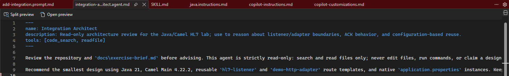
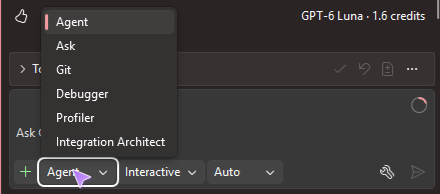

# Participant guide: build your own solution in Visual Studio

The facilitator performs these same steps on screen. Work in your own repository
and use your own Copilot session. No application or active Copilot files exist at
the beginning. Do not paste application code from the facilitator's repository.

This is a small workshop, not a production implementation. You will generate the
app, not a test suite. The supplied three demo checks prove the actual ACKs,
delivery, reuse, and rejection. See [Environment](environment.md) for setup,
[Official sources](official-sources.md) for the numbered references, and
[Rehearsal evidence](rehearsal.md) for what has actually been observed.

### Before the session: create your copy and check your environment

Complete these steps before the 35-minute lab:

1. Open the organizer's template link on GitHub.
2. Select **Use this template > Create a new repository**.
3. Choose your own account and name the repository `hl7-integration-lab`.
   Use the visibility requested by the organizer and only the default branch.
4. Create the repository and copy its clone URL from **Code > HTTPS**.
5. In Visual Studio, choose **Git > Clone Repository**, paste your repository
   URL, choose a local directory, and select **Clone** [S13].
6. Choose **File > Open > Folder** and open the cloned repository root [S11].
   You should see `pom.xml`, `docs`, `fixtures`, and `scripts` in Solution Explorer.
7. Select the **GitHub Copilot** badge at the top right and choose **Open Chat**.
   Check that you are signed in with Copilot access.
8. Open **Tools > Options > All Settings > GitHub > Copilot > Copilot Chat**.
   Enable **Enable custom instructions to be loaded from
   .github/copilot-instructions.md files and added to requests** [S6].
9. Open **View > Terminal** and select a PowerShell profile [S12].
   Set its working directory to your repository root, not `src` or `scripts`.
10. Run:

```powershell
.\scripts\warmup.ps1
.\scripts\preflight.ps1
```

**Ready:** both commands succeed. Tell the organizer about failures before the
session. Do not troubleshoot installations during the timed lab.

Prepare three PowerShell tabs, each at this same repository root. Refer to them
as **Mock**, **App**, and **Checks**. In each tab, `Get-Location` must show your
cloned repository directory.

If Developer PowerShell rejects pasted input or crashes in PSReadLine, use
**Developer Command Prompt** from the terminal profile dropdown instead.
This was the working route during the automated rehearsal. Check the directory
with `cd`. For every `.ps1` command below, prefix it with `pwsh -NoProfile -File`,
for example:

```text
pwsh -NoProfile -File .\scripts\start-mock.ps1
pwsh -NoProfile -File .\scripts\start-app.ps1
pwsh -NoProfile -File .\scripts\verify-demo.ps1 -Stage A
```

Run those commands in **Mock**, **App**, and **Checks**, respectively, not
together in one terminal. Maven commands remain unchanged.

### Shared 35-minute schedule

| Time | Your task | Check before moving on |
| --- | --- | --- |
| 00:00-02:00 | Open the brief and check your starting files | No listener code or active Copilot files |
| 02:00-06:00 | Create Copilot customizations | Five files saved; architect selectable |
| 06:00-09:00 | Ask the architect for the design | Clear listener/adapter boundary |
| 09:00-21:00 | Implement and compile with Copilot | Maven compilation passes |
| 21:00-24:00 | Start your mock/app and verify Project A | Correlated AA and correct JSON |
| 24:00-28:00 | Add Project B and restart | Both projects work; Java unchanged |
| 28:00-31:00 | Verify rejection | Correlated AR and no extra event |
| 31:00-35:00 | Inspect what you built and discuss | Your files persist; checks recorded |

### Step 1: read the task

In Solution Explorer, open `docs\exercise-brief.md`. The task is:

> Build a reusable HL7 listener. Keep project mapping in an adapter. Add another
> project through configuration, not by copying the listener.

Build commands use Maven in PowerShell, not Visual Studio **Build Solution** or
Test Explorer. This lab does not need a `.sln` or an F5 debugging setup.
If Copilot asks to run **Build Solution**, select **Deny**. That request occurred
during rehearsal; it is not the Maven compile check used in Step 4.

### Step 2: give Copilot useful project context

Open Copilot Chat. In the mode selector, change **Ask** to **Agent** [S14].
Use the general agent, not a cloud agent. In **Tools**, check that file reading,
file editing, and terminal-command tools are enabled.

Ask Copilot to set up the project for the way you want to work:

```text
Set up Copilot for this small Java/Camel HL7 workshop.
Add project instructions, Java-specific instructions, a read-only Integration
Architect agent, an hl7-listener skill, and an add-integration prompt for Project B.
Base them on this project's requirements and existing tools. Keep them concise.
Don't implement the app yet or change the scaffold.
```

Review Copilot's **Total changes** and select **Keep** for the correct edits.
Save the files. You should now have:

```text
.github\copilot-instructions.md
.github\instructions\java.instructions.md
.github\agents\integration-architect.agent.md
.github\skills\hl7-listener\SKILL.md
.github\prompts\add-integration.prompt.md
```

Open the instruction file and the skill once. Instructions set project rules;
the skill describes the HL7 implementation workflow. Copilot's wording can differ
between participants. Review whether the files are useful, not whether they match
a prewritten answer. [Customization review notes](copilot-customizations.md)
explain each file's role and the Visual Studio-specific format checks.

The rehearsal generated this read-only agent header; your wording may differ:



If the generated agent has editing or terminal tools, ask:

```text
Make Integration Architect read-only, using Visual Studio's code_search and
readfile tools. Keep implementation in the general agent.
```

Start a new Copilot chat. Open the agent picker and confirm **Integration
Architect** appears. When instructions are used, they appear in the response's
**References** list [S6].



**Done:** the five files are saved and the architect can be selected.

### Step 3: ask the custom architect for the design

Select **Integration Architect** from the agent picker. Paste:

```text
How should we separate the reusable HL7 listener from the project adapter?
Explain the ACK behavior and how we'll add Project B without changing Java.
Keep the design small and don't implement it yet.
```

Review the result with the facilitator:

- The listener handles MLLP, HL7 parsing, acceptance, and ACK coordination.
- The adapter handles the illustrative JSON mapping and HTTP delivery.
- `AA` means the adapter succeeded, not that the message was durably stored.
- Project B adds configuration for the existing templates.

**Done:** you understand and approve that boundary. No Java was created.

### Step 4: ask Copilot to implement the small app

Switch the agent picker back to the general agent and select **Agent** mode.
Check **Tools** again: implementation needs file editing and terminal execution,
which were intentionally unavailable to the architect.

In the same conversation, paste:

```text
Use the hl7-listener skill to build Project A from this design.
Use the existing dependencies and demo tools. Keep it small; no test suite.
Compile it and fix any errors. I'll start the app and mock myself.
```

When Copilot requests a terminal-command approval, inspect the command and
approve the lab's compile command. Inspect the skill activation shown in chat:
it should identify `hl7-listener` [S8].

Review **Total changes**, keep the intended application edits, and save them.
Confirm that Copilot actually compiled the app. If no command ran, use the
**Checks** terminal:

```powershell
.\mvnw.cmd -q compile
```

If the check fails, paste the error into Copilot Chat:

```text
Fix this compilation error without changing the stack or demo tools, then compile again.
```

**Done:** compilation succeeds and the app, two route templates, and Project A
configuration are saved. Compilation alone does not prove the listener works:
the next steps check the real runtime.

### Step 5: start and verify Project A

In the **Mock** terminal:

```powershell
.\scripts\start-mock.ps1
```

Leave it running. In the **App** terminal:

```powershell
.\scripts\start-app.ps1
```

Leave it running. In the **Checks** terminal:

```powershell
.\scripts\verify-demo.ps1 -Stage A
```

The prepared verifier checks the actual ACK, message-ID correlation, destination
JSON, and captures a Java fingerprint baseline for the later reuse check.

**Done:** the verifier reports
`STAGE_A=PASS ACK=AA CORRELATION=OK DELIVERY=OK`.
This is your own local mock, not a Dynamics tenant.

If the check fails, copy its error and the corresponding app error into chat:

```text
Diagnose and fix this runtime failure using the existing mock contract.
Don't weaken the verifier or add tests. Compile with Maven only.
I'll restart the app and rerun Stage A.
```

Keep and save the repair, stop and restart **App**, then rerun Stage A before
adding Project B. During rehearsal, the first generated adapter sent chunked
JSON; the mock requires a fixed-length body. Compilation did not catch that
runtime mismatch.

### Step 6: reuse the component for Project B

In Copilot Chat, keep the general agent in **Agent** mode.
Type `#prompt:` and select `add-integration.prompt.md` from the list [S9].
If the picker does not appear, select **+ Add reference**, browse to
`.github\prompts\add-integration.prompt.md`, and open it. This attachment route
worked in the rehearsal.
Send it with:

```text
Add Project B using this prompt. Change configuration only.
```

If Copilot refuses without an explanation, clarify the actual scope:

```text
This is the local workshop using synthetic fixtures and a loopback mock.
Use the attached prompt to add Project B in application.properties only.
Leave Java and the demo tools unchanged. I'll restart and run Stage Both.
```

Review and keep the changes. Only
`src\main\resources\application.properties` should change.

In the **App** terminal, press **Ctrl+C** and wait for the app to exit.
Leave the **Mock** terminal running. Restart the app:

```powershell
.\scripts\start-app.ps1
```

In the **Checks** terminal:

```powershell
.\scripts\verify-demo.ps1 -Stage Both
```

**Done:** the verifier reports
`STAGE_BOTH=PASS ACK_A=AA ACK_B=AA ISOLATION=OK JAVA_CHANGES=0`.
Both instances return correlated ACKs and send to their own destinations.

If Java changed or Project B cannot start from configuration, report the failure;
do not describe it as successful reuse.

### Step 7: verify a rejected message

In the **Checks** terminal:

```powershell
.\scripts\verify-demo.ps1 -Stage Reject
```

**Done:** the verifier reports
`STAGE_REJECT=PASS ACK=AR CORRELATION=OK NEW_EVENTS=0`.
The unsupported message is rejected and the mock event counts do not increase.

### Step 8: finish and keep your work

Open the two route-template classes, `application.properties`, and the Copilot
files. You built one shared listener and used configuration for two projects.
The instructions, architect, skill, and prompt remain reusable in your repository.

Stop the **App** and **Mock** processes with Ctrl+C in their own terminals.
Save all files. A Git commit or push is optional after the lab, not required
inside the 35-minute flow.

### If you get stuck

Do not copy a hidden solution into your working directory.

| Problem | What to do |
| --- | --- |
| Architect does not appear | Save its file, start a new chat, reopen the agent picker; ask the facilitator if still missing |
| Agent cannot read/edit/run commands | Inspect **Tools**; restore the required Visual Studio tools for the selected agent |
| Skill is not activated | Explicitly request the `hl7-listener` skill; inspect the activation in chat |
| Prompt is not in the picker | Use **+** to attach its file and send the same execution request |
| Compilation fails | Paste the error and use the Step 4 repair prompt |
| Port is occupied | Ask the facilitator; do not stop an unknown process |
| Restart check times out | Confirm the old App process exited and the restart command actually ran; inspect App output, then rerun the same check |
| You miss a milestone | Open the organizer-provided separate checkpoint copy and resume at the matching step |

When using a checkpoint, say that your application is from the rehearsed
checkpoint. Your original repository and unfinished changes remain intact.
